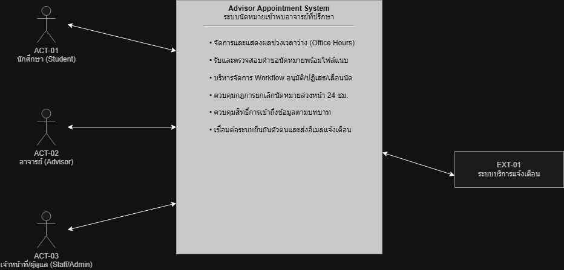

# 11 — Conceptual Architecture

> **Week 11 Deliverable**  
> **โครงการ:** ระบบนัดหมายเข้าพบอาจารย์ที่ปรึกษา (Advisor Appointment System)  
> **ทีม:** ENGSE206 Group 4 | **เวอร์ชัน:** v0.1 — Design Draft | **สถานะ:** Baseline Candidate  
> **เอกสารอ้างอิง:** [07-srs-v1.md](../docs/07-srs-v1.md), [10-design-strategy.md](10-design-strategy.md)  
> **Stack อ้างอิง (Proposed):** React · Node.js + Express · PostgreSQL  

---

ระบบนัดหมายเข้าพบอาจารย์ที่ปรึกษาออกแบบโดยใช้ Layered Architecture ซึ่งแบ่งการทำงานออกเป็น 3 ชั้นหลัก เพื่อแยกระหว่างส่วนการแสดงผล (Presentation), ส่วนตรรกะทางธุรกิจ (Business Logic/API), และส่วนจัดเก็บข้อมูล (Data Storage) อย่างเป็นระบบ

## 2. System Context (C4 ระดับ 1)

System Context แสดงระบบนัดหมายเข้าพบอาจารย์ที่ปรึกษาเป็น **กล่องเดียว** ร่วมกับผู้ใช้งาน (Actors) และระบบภายนอก (External Systems) เพื่อนิยามขอบเขตสิ่งที่ระบบรับผิดชอบและไม่รับผิดชอบ

### ตาราง Actors และ External Systems

| ID | ชื่อ | บทบาท / สิ่งที่ส่งเข้าระบบ | สิ่งที่รับจากระบบ | สถานะในรุ่นแรก |
|---|---|---|---|---|
| **ACT-01** | นักศึกษา (Student) | ค้นหาช่วงเวลาว่างของอาจารย์, ส่งคำขอนัดหมาย (ระบุหัวข้อ, สมาชิก, รูปแบบ On-site/Online, แนบไฟล์), ติดตามสถานะคำขอ | หมายเลขอ้างอิงคำขอ (Appointment ID), สถานะการพิจารณา, ผลการนัดหมาย, การแจ้งเตือน | **Core** |
| **ACT-02** | อาจารย์ที่ปรึกษา (Advisor) | กำหนดช่วงเวลาว่าง (Office Hours), ตรวจสอบคำขอนัดหมาย, อنุมัติ/ปฏิเสธ/ขอเลื่อนนัด พร้อมระบุเหตุผล | รายการคำขอนัดหมายที่ส่งถึงตนเอง, ข้อมูลนักศึกษาและไฟล์ประกอบ, สรุปตารางนัดหมาย | **Core** |
| **ACT-03** | ผู้ดูแลระบบ (System Administrator) | กำหนดบทบาท/สิทธิ์ (RBAC), ตรวจสอบความถูกต้องของระบบ, ดู Audit Log ของการนัดหมาย | รายงานประวัติการทำงานย้อนหลัง (Audit Trail), สรุปข้อมูลการใช้งานระบบ | **Core** |
| **EXT-01** | University Identity Service (SSO) | ส่ง User Reference และ Role Claim (ข้อมูลยืนยันตัวตนและบทบาทของนักศึกษา/อาจารย์) | คำขอยืนยันตัวตนผู้ใช้งานและสิทธิ์การเข้าถึงระบบ | **Core boundary** (Protocol/Format = TBD) |
| **EXT-02** | Institutional Notification Service | ส่งผลลัพธ์การส่งข้อความแจ้งเตือนผ่าน Email สถาบัน และ Web Notification | ข้อมูลเหตุการณ์การเปลี่ยนสถานะคำขอเพื่อส่งแจ้งเตือนผู้ใช้ | **Core / Extension** (Email + Web Notification) |
| **EXT-03** | Dedicated File / Object Storage | ส่ง URL / Path ของไฟล์เอกสารแนบประกอบคำขอ (`.pdf`, `.docx`) ที่จัดเก็บสำเร็จ | ไฟล์เอกสารประกอบคำขอที่ผ่านการตรวจสอบความถูกต้องแล้ว | **Core** (เกณฑ์ขนาดไฟล์ไม่เกิน 10MB) |

## 3. Container diagram (C4 ระดับ 2)

ซูมเข้าสู่ภายในระบบเพื่อระบุ **3 Containers หลัก** ที่ต้องรันขึ้นมาทำงาน พร้อมระบุเทคโนโลยี สภาพแวดล้อม และความรับผิดชอบ:

| Container | หน้าที่และความรับผิดชอบ | ชนิดและ Stack (Proposed) | รันที่ไหน / ใครควบคุม | ข้อมูลที่จัดเก็บ | การเชื่อมต่อสื่อสาร |
|---|---|---|---|---|---|
| **Web Application** | นำเสนอหน้าจอแบบ Responsive สำหรับนักศึกษา, อาจารย์ และผู้ดูแลระบบ: หน้าค้นหา Office Hours, ฟอร์มส่งคำขอนัดหมาย, หน้า Dashboard ติดตามสถานะ, และ Advisor Management Console สำหรับพิจารณาคำขอ | เว็บแอปพลิเคชันฝั่ง Client ในเบราว์เซอร์ · **React** | รันบนเว็บเบราว์เซอร์ของผู้ใช้ — **ผู้ใช้ควบคุม** | ไม่เก็บข้อมูลถาวร (เก็บบบน Memory / Client State ชั่วคราว) | เชื่อมต่อไปยัง API Application ผ่าน REST/JSON (HTTPS) |
| **API Application** | ศูนย์กลางการบังคับใช้กฎทางธุรกิจ (กฎการยกเลิก 24 ชม. BR-01, การตรวจสอบสิทธิ์ RBAC ตาม D3, การออก Appointment ID ตาม D1, การเปลี่ยนสถานะผ่าน FSM และบันทึก Audit Log ตาม D2) | โปรแกรมฝั่งเซิร์ฟเวอร์ (Backend Service) · **Node.js + Express** | รันบน Server ของทีม — **ทีมควบคุม** | ไม่เก็บข้อมูลถาวรเอง ประสานงานผ่าน Database และ Object Storage | รับ REST/JSON จาก Web App, สื่อสารกับ Database ด้วย SQL/Transaction, สื่อสารกับ EXT-01..03 ผ่าน API/HTTP |
| **Database** | แหล่งจัดเก็บข้อมูลหลักของระบบ รองรับ ACID Transactions สำหรับข้อมูลผู้ใช้งาน, ช่วงเวลาว่างของอาจารย์ (Office Hours), คำขอนัดหมาย, ไฟล์แนบ, สถานะ และ Audit Log | ฐานข้อมูลเชิงสัมพันธ์ (Relational Database) · **PostgreSQL** | รันบน Database Server — **ทีมควบคุม** (เข้าถึงได้เฉพาะ API) | ข้อมูลผู้ใช้, Office Hours, คำขอนัดหมาย, สถานะ, ประวัติการเปลี่ยนสถานะ, Audit Log | เชื่อมต่อกับ API Application ผ่าน TCP/SQL เท่านั้น |

### รูปภาพ Container Diagram (C4 Level 2)

> *(เว้นว่างสำหรับวางภาพไดอะแกรมจาก draw.io: `diagrams/architecture/container-c4-level2.png`)*  
> 

---

## 3. Components / Modules

| Component | Responsibilities | Inputs/Outputs | Related Requirements |
|---|---|---|---|
| **User Interface** | แสดงหน้าจอและรับข้อมูลจากผู้ใช้งาน เช่น ค้นหาตารางว่าง ส่งคำขอนัดหมาย และติดตามสถานะ | Input: ข้อมูลจากผู้ใช้ / Output: คำขอไปยัง API และข้อมูลผลลัพธ์ | FR-01, FR-02, FR-04 |
| **Authentication & Authorization** | ตรวจสอบตัวตนผ่าน SSO (EXT-01) และควบคุมสิทธิ์การเข้าถึงระบบตามบทบาท (RBAC) | Input: ข้อมูลการเข้าสู่ระบบและบทบาท / Output: ผลการยืนยันตัวตนและสิทธิ์ | NFR-03, RC-07 |
| **Office Hours Management** | จัดการและแสดงช่วงเวลาว่างของอาจารย์ที่ปรึกษาให้นักศึกษาเลือกจอง | Input: ข้อมูลตารางเวลาจากอาจารย์ / Output: รายการช่วงเวลาว่าง | FR-01, RC-01 |
| **Appointment Booking & Review** | จัดการคำขอนัดหมาย ตรวจสอบความถูกต้อง ส่งคำขอ และพิจารณาอนุมัติ/ปฏิเสธ/เลื่อนนัด | Input: รายละเอียดคำขอและเอกสารแนบ / Output: สถานะการนัดหมาย | FR-02, FR-03, RC-02, RC-03 |
| **Status & Notification Service** | จัดการวงจรสถานะนัดหมาย (FSM) และประสานงานส่ง Email / Web Notification (EXT-02) | Input: การเปลี่ยนสถานะคำขอ / Output: การแจ้งเตือนไปยังผู้ใช้ | FR-03, FR-04, RC-04, RC-06 |
| **Audit & History Management** | บันทึกและเรียกดูประวัติการเปลี่ยนแปลงสถานะและ Audit Trail แบบ Append-only | Input: การเปลี่ยนแปลงข้อมูล / Output: ประวัติการดำเนินงานย้อนหลัง | BR-04, FR-10 |
| **Data Storage** | จัดเก็บข้อมูลผู้ใช้งาน, Office Hours, คำขอนัดหมาย, สถานะ และประวัติ | Input: ข้อมูลจาก Application / Output: ข้อมูลสำหรับการเรียกใช้ | FR-01 ถึง FR-04, NFR-03 |
| **Document / File Storage** | จัดเก็บและเรียกใช้ไฟล์เอกสารแนบประกอบคำขอ (EXT-03) | Input: ไฟล์ `.pdf`, `.docx` / Output: ไฟล์หรือ URL อ้างอิงสำหรับเรียกดู | FR-02, EXT-03 |

---

| Dependency | Purpose | Risks / Constraints | Related Design Decision |
|---|---|---|---|
| **Database** | จัดเก็บข้อมูลคำขอนัดหมายและหมายเลขอ้างอิง | หมายเลขอ้างอิงคำขอ (Appointment ID) ต้องไม่ซ้ำกันในระบบ | D1 |
| **Appointment Status** | จัดการและแสดงสถานะวงจรชีวิตของคำขอนัดหมาย | ต้องกำหนดสถานะและเงื่อนไข FSM ในการเปลี่ยนสถานะให้ชัดเจน | D2 |
| **Authentication & Authorization** | ควบคุมการเข้าถึงระบบตามบทบาทผู้ใช้ (Student, Advisor, Admin) | ต้องป้องกันการเข้าถึงข้อมูลคำขอข้ามบุคคล (Data Isolation) | D3 |

## 6. Decision cards

บันทึกการตัดสินใจทางสถาปัตยกรรม (Architectural Decision Records - ADR แบบย่อ):

### DEC-01: กติกาทางธุรกิจและการควบคุมสิทธิ์อยู่ที่ API Application
- **สถานะ:** Proposed
- **การตัดสินใจ:** ให้ API Application เป็นจุดศูนย์กลางแห่งเดียวในการตรวจสอบสิทธิ์ RBAC (D3) และบังคับใช้กฎทางธุรกิจ เช่น กฎการยกเลิกล่วงหน้า 24 ชม. (BR-01)
- **เหตุผล (Drivers/NFR):** NFR-03, D3, หลักการ Least Privilege และป้องกันการแก้ไขข้อมูลข้ามสิทธิ์จากฝั่ง Client
- **ทางเลือกที่ไม่เลือก:** ตรวจสอบสิทธิ์ที่หน้าเว็บอย่างเดียว (ไม่ปลอดภัย ผู้ใช้สามารถดัดแปลงคำขอได้)
- **ผลที่ตามมา:** หน้าเว็บทำหน้าที่เพียงซ่อน/แสดงเมนูตามบทบาทเพื่อความสะดวก แต่การอนุมัติสิทธิ์ขั้นสุดท้ายกระทำที่ API เสมอ

### DEC-02: ใช้ฐานข้อมูลเชิงสัมพันธ์เดียวที่รองรับ Transaction เป็นศูนย์กลางความถูกต้อง
- **สถานะ:** Proposed
- **การตัดสินใจ:** รวมการจัดเก็บข้อมูลหลัก (Office Hours, คำขอ, สถานะ, ประวัติ, Audit Log) ไว้ใน Relational Database เดียวกัน และใช้ Database Transaction ในกระบวนการจองและเปลี่ยนสถานะ
- **เหตุผล (Drivers/NFR):** D1 (Appointment ID ห้ามซ้ำ), D2 (การเปลี่ยนสถานะต้องสมบูรณ์), ป้องกันปัญหาจองเวลาชนกัน (Double Booking)
- **ทางเลือกที่ไม่เลือก:** แยกฐานข้อมูลตามหน้าที่ (Micro-databases) ซึ่งเพิ่มภาระในการควบคุมความสอดคล้องของข้อมูล
- **ผลที่ตามมา:** รองรับ ACID ได้ง่าย และรับประกันความถูกต้องของตารางนัดหมาย

### DEC-03: สถาปัตยกรรม Responsive Web Application หน้าจอเดียวแบ่งตามบทบาท
- **สถานะ:** Proposed
- **การตัดสินใจ:** พัฒนา Web Application เดียวแบบ Responsive Web ที่ปรับการแสดงผลและเมนูตามสิทธิ์ของผู้ใช้ (Student, Advisor, Admin)
- **เหตุผล (Drivers/NFR):** NFR-01, สะดวกต่อการเข้าถึงผ่านสมาร์ตโฟนหรือคอมพิวเตอร์เบราว์เซอร์ของสถาบัน
- **ทางเลือกที่ไม่เลือก:** พัฒนา Native Mobile App แยก iOS/Android (เพิ่มต้นทุนและระยะเวลาพัฒนาโดยไม่จำเป็น)
- **ผลที่ตามมา:** ลดความซ้ำซ้อนในการพัฒนา โดยเน้นออกแบบ UI/UX บนเบราว์เซอร์เป็นหลัก

### DEC-04: เทคโนโลยี Stack อ้างอิง (React · Node.js + Express · PostgreSQL)
- **สถานะ:** Proposed
- **การตัดสินใจ:** เลือกใช้ชุดเทคโนโลยีมาตรฐาน: Web = React, API = Node.js + Express, DB = PostgreSQL
- **เหตุผล (Drivers/NFR):** สอดคล้องกับความต้องการของระบบ ทีมมีความคุ้นเคย และรองรับการจัดการ Transaction ได้อย่างมีเสถียรภาพ
- **ทางเลือกที่ไม่เลือก:** สถาปัตยกรรม Microservices หรือภาษาอื่นที่ทีมไม่มีความเชี่ยวชาญ
- **ผลที่ตามมา:** เป็นกรอบการทำงานตั้งต้นสำหรับพัฒนา Prototype และส่งต่อให้ทีมพัฒนาตรวจสอบต่อไป

> *(เว้นว่างสำหรับวางภาพไดอะแกรมการวางตำแหน่งกติกา D1/D2: `diagrams/architecture/d1-d2-rule-placement.png`)*  
> 

---

## 7. เดิน Spine บน container diagram

การทดสอบเส้นทางคำขอนัดหมาย (Design Spine) ทั้ง 4 ขั้นตอนผ่านแต่ละ Container:

| ขั้นที่ | กิจกรรมในเส้นทางคำขอ (Design Spine) | Use Case & Requirement | ระดับในโครงการ | การเดินผ่าน Container (W11 Walkthrough) |
|---|---|---|---|---|
| **1** | ค้นหาช่วงเวลาว่างของอาจารย์ (Office Hours) และส่งคำขอนัดหมายพร้อมแนบไฟล์เอกสาร | UC-01, FR-01, FR-02 | **Build now** | **Web App** (เลือกเวลา/กรอกข้อมูล/แนบไฟล์) → **API App** (ตรวจความครบถ้วน, ออก Appointment ID แบบไม่ซ้ำตาม D1, ส่งไฟล์เก็บ EXT-03) → **Database** (บันทึกคำขอสถานะ `Pending`) |
| **2** | ติดตามสถานะคำขอนัดหมายและการรับการแจ้งเตือนเมื่ออาจารย์พิจารณา | UC-02, FR-03, FR-04 | **Build now** | **Web App** (นักศึกษาเปิดดูสถานะ) → **API App** (ดึงข้อมูลเฉพาะคำขอของนักศึกษาตาม D3) → **Database** (อ่านข้อมูลสถานะและ Timeline) *(หากอาจารย์เปลี่ยนสถานะ API จะส่งคำสั่งให้ EXT-02 แจ้งเตือนผ่าน Email/Web)* |
| **3** | อาจารย์ตรวจสอบตารางเวลาและพิจารณาคำขอนัดหมาย (อนุมัติ, ปฏิเสธ หรือขอเลื่อนนัด) | UC-03, FR-03, BR-01 | **Overview** | **Web App** (อาจารย์เปิดหน้าพิจารณาคำขอ) → **API App** (ตรวจสอบสิทธิ์ Advisor ตาม D3, ตรวจสอบกฎ FSM และบันทึกเหตุผล) → **Database** (อัปเดตสถานะคำขอ) |
| **4** | ระบบบันทึกประวัติการเปลี่ยนสถานะ (Status History) และ Audit Log แบบ Append-only | FR-10, BR-04 | **Build now** | **Web App** (แสดงประวัติการนัดหมาย) → **API App** (บันทึก Audit Log อัตโนมัติทุก Transaction) → **Database** (บันทึกตาราง Audit Log แบบ Append-only ห้ามแก้ไข) |
| **ข้ามสาย** | การควบคุมสิทธิ์ RBAC และการรักษาความปลอดภัยของข้อมูลการปรึกษา | NFR-03, RC-07 | **Build now (Cross-cutting)** | ตรวจสอบสิทธิ์ทุกคำขอที่ **API App** และจำกัดการเข้าถึงข้อมูลเฉพาะผู้เกี่ยวข้อง |

---

## 8. Open decisions ที่กระทบ container

ข้อตัดสินใจที่ยังเปิดอยู่ (Open Decisions) และแนวทางการจัดการที่ส่งผลกระทบต่อ Container:

| ID | เรื่อง (Open Decision) | กระทบ Container ใด | แนวทางดำเนินการระหว่างรอข้อสรุป |
|---|---|---|---|
| **OD-01** | นโยบายการเชื่อมต่อ Google Calendar สองทาง (Two-Way Sync) (ISSUE-ADV-01) | API Application, External Calendar API | ชะลอการเชื่อมต่อภายนอก (Hold/Provisional) และใช้ปฏิทินภายในระบบก่อนตามนโยบาย Data Privacy |
| **OD-02** | ช่องทางเสริมการแจ้งเตือนนอกเหนือจาก Email สถาบัน (เช่น LINE Integration) (ISSUE-ADV-02) | API Application, External Notification API | กำหนดขอบเขตให้ใช้ Email สถาบันและ Web Notification เป็นหลักก่อนในรุ่นแรก |
| **OD-03** | ระยะเวลาการจัดเก็บข้อมูลประวัติการให้คำปรึกษา (Data Retention Policy) | Database | กำหนดกรอบเวลาการเก็บข้อมูลคำปรึกษาร่วมกับอาจารย์ที่ปรึกษา |

---

## 9. ส่งต่อ W12 และ W13

การส่งต่องาน Conceptual Architecture ไปยังสัปดาห์ถัดไป:

- **ส่งต่อ W12 (UX/UI Prototype):**
  - นำขอบเขตของหน้าจอใน Web Application (หน้าค้นหา Office Hours, ฟอร์มขอนัดหมาย, หน้าติดตามสถานะ, และ Dashboard อาจารย์) ไปออกแบบ Wireframe และ Interactive Prototype
  - ออกแบบ Form Validation ฝั่ง Client ให้สอดคล้องกับข้อกำหนดการส่งคำขอไม่เกิน 3 ขั้นตอน (NFR-01)
- **ส่งต่อ W13 (Detailed Design & Component Architecture):**
  - ซูมเข้าสู่ภายใน API Application เพื่อแบ่งเป็น Component ย่อย (เช่น Appointment Controller, Workflow Engine, Notification Service, Audit Manager)
  - จัดทำ Sequence Diagram แสดงลำดับการทำงานระหว่าง Web App, API Controller, Service, และ Database ตามเส้นทาง Spine
- **ส่งต่อ W14 (Developer Handoff):**
  - ใช้ Container Diagram และ Decision Cards (DEC-01 ถึง DEC-04) เป็นเอกสารตั้งต้นในการส่งมอบงานให้ทีมพัฒนา

---

## 10. Done checklist W11

- [x] **Context Diagram (C4 Level 1):** มีระบบ 1 กล่อง แสดง Actors (ACT-01..03) และระบบภายนอก (EXT-01..03) ครบถ้วนพร้อมป้ายกำกับ
- [x] **Container Diagram (C4 Level 2):** ระบุ 3 Containers หลัก (Web, API, DB) พร้อมระบุชนิด เทคโนโลยี และหน้าที่
- [x] **สภาพแวดล้อมและการควบคุม:** ระบุชัดเจนว่าชิ้นใดรันที่ใด ใครเป็นผู้ควบคุม และมีเส้นแบ่งความไว้ใจ (Trust Boundary)
- [x] **การกระจาย NFR:** วิเคราะห์ผลกระทบของ NFR-01 ถึง NFR-03 ลงสู่แต่ละ Container อย่างครบถ้วน
- [x] **Decision Cards:** มีการบันทึกการตัดสินใจหลัก (DEC-01 ถึง DEC-04) อ้างอิง Driver D1–D3 และ NFR
- [x] **Spine Walkthrough:** เส้นทางคำขอทั้ง 4 ขั้นตอนสามารถเดินผ่าน Container ได้จริงโดยไม่มีจุดสะดุด
- [x] **Open Decisions:** ระบุผลกระทบของ OD-01 ถึง OD-03 พร้อมแนวทางปฏิบัติระหว่างรอคำตอบ
- [x] **โครงสร้าง 11 หัวข้อ:** สอดคล้องกับมาตรฐาน Workshop W11 ครบถ้วน

---

## 11. AI use และ Team worklog

### การใช้งาน AI (AI Assistance Log)

| เครื่องมือ AI | ขอบเขตงานที่ใช้ช่วย | วิธีการตรวจสอบความถูกต้องโดยมนุษย์ |
|---|---|---|
| Gemini | ช่วยจัดโครงสร้างเอกสารตามมาตรฐาน 11 หัวข้อ และปรับเนื้อหาจากระบบแจ้งปัญหาเป็นระบบนัดหมายอาจารย์ | ทีมงานตรวจสอบความสอดคล้องกับ SRS (07-srs-v1.md) และเอกสาร W10 อย่างละเอียด |

### บันทึกการทำงานของทีม (Team Worklog)

| สมาชิกผู้รับผิดชอบ | บทบาทหน้าที่ | ส่วนงานที่รับผิดชอบใน W11 | สถานะงาน |
|---|---|---|---|
| จิราพัชร อินจันทร์ | System Analyst / Developer | จัดทำเนื้อหา System Context และ Container Diagram | ดำเนินการแล้ว |
| จักรพงศ์ หมื่นไชยศรี | Architecture Designer | ออกแบบ Decision Cards และ Quality Attribute Tactics | ดำเนินการแล้ว |
| ญาณวุฒิ ชวนอาจ | Backend & Integration | ตรวจสอบการเชื่อมต่อ External Systems และ Security Constraints | ดำเนินการแล้ว |